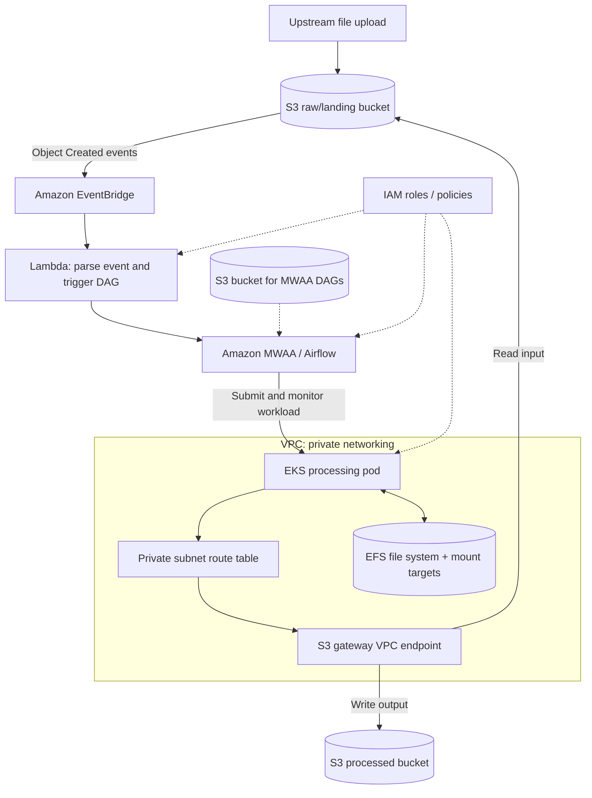
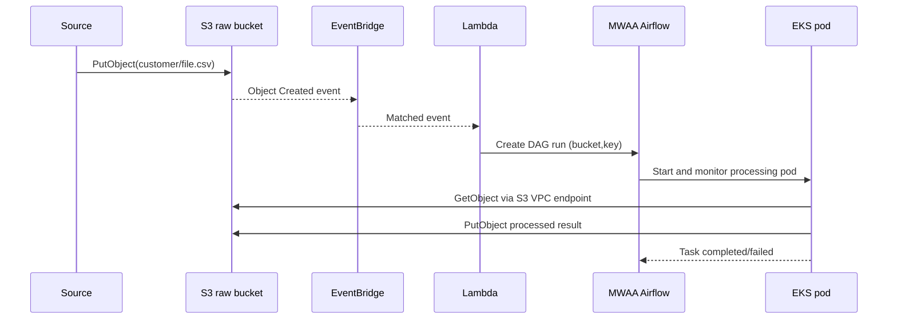
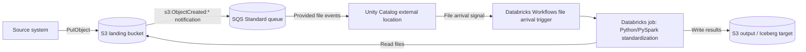

# AWS Data Engineering Architecture and Private Networking
_Last updated: 2026-10-26 (America/Chicago)_

> **Living learning notes.** This guide connects AWS accounts, IAM, S3, EKS, VPCs, PrivateLink, allowlists, EFS, Amazon MWAA (managed Airflow), Lambda, and event-driven processing. Extend existing sections or append new ones as more topics are covered. Examples are illustrative; use an isolated sandbox.

## 1. The big picture

An enterprise data platform typically separates **storage**, **compute**, **orchestration**, **networking**, and **authorization**. The services below play different roles:

| Component | Role in the architecture | Typical example |
| --- | --- | --- |
| AWS account | Ownership, administration, security and billing boundary | Dev, test and production accounts |
| IAM role and policies | Identity and permissions: what can a workload do? | EKS application can read only designated S3 prefixes |
| Amazon S3 | Durable object storage | Raw files, processed results, Airflow DAG files |
| Amazon VPC | Isolated virtual network | Private subnets containing EKS workers |
| Amazon EKS | Managed Kubernetes control plane for container applications | Python/PySpark processing pods |
| S3 gateway VPC endpoint | Private route from workloads in a VPC to regional S3 | EKS -> S3 without NAT |
| S3 interface endpoint (PrivateLink) | Private-IP interface endpoint to S3 | On-premises Spark -> Direct Connect -> endpoint -> S3 |
| Network allowlist | Firewall, security-group or service-policy restrictions | HTTPS from approved source range |
| Amazon EFS | Shared elastic network file system | Persistent shared files mounted by pods |
| Amazon MWAA | Managed Apache Airflow orchestration | DAG validates, processes and monitors a file |
| AWS Lambda | Short event-driven function | Validate event metadata and trigger a DAG |
| EventBridge | Filter and route events | Only create events under a specific S3 key prefix |

### High-level reference architecture



The diagram is logical, not a literal map of AWS service placement. S3, IAM and EventBridge are not hosted inside your VPC. Lambda can operate outside your VPC or be VPC-attached when necessary; MWAA requires VPC network configuration.

### Example end-to-end event

1. A producer uploads `s3://example-raw/customer/2026-10-19/customer.csv`.
2. S3 emits an object-created event to EventBridge (after S3 EventBridge delivery is enabled).
3. An EventBridge rule filters for the raw bucket and the `customer/` prefix and invokes Lambda.
4. Lambda reads the bucket/key, validates the event, and invokes the authorized MWAA API to create a DAG run with a unique, meaningful run ID and configuration (`bucket`, `key`).
5. MWAA orchestrates checks, starts a workload in EKS, monitors its result, and retries failed tasks according to DAG policy.
6. The EKS pod assumes an IAM role (e.g., via EKS Pod Identity or IAM Roles for Service Accounts) and reads/writes S3 over HTTPS through a gateway endpoint.
7. If the application needs shared mounted files, pods use EFS; Airflow completes and records logs/metrics.

**Important:** the S3 event that invokes Lambda is a different flow from the later S3 read/write path used by EKS. Avoid confusing event delivery with data-plane connectivity. S3 notifications are typically at-least-once and can be duplicated or delivered out of order. Use idempotent processing and, when needed, an intermediary queue (SQS) or durable state.

## 2. AWS accounts and IAM roles

- **AWS account:** owner of resources and a boundary for billing and policy administration. Organizations may impose service-control policies (SCPs).
- **IAM policy:** JSON specifying allowed/denied API actions on resources, optionally conditioned on context.
- **IAM role:** assumable identity for EC2, EKS pods, Lambda, MWAA or another principal. Workloads should use short-lived role credentials, not embedded access keys.
- **IAM authorization vs networking:** a successful TCP/HTTPS connection does not imply `s3:GetObject` is allowed. Conversely, an IAM Allow does not create a route to S3.
- EKS pod permissions should be scoped by bucket and key prefix and use EKS Pod Identity or IRSA as appropriate.

Sample **identity-based** read-only policy (attach to an approved workload role):

```json
{
  "Version": "2012-10-17",
  "Statement": [
    {
      "Effect": "Allow",
      "Action": ["s3:ListBucket"],
      "Resource": "arn:aws:s3:::example-raw",
      "Condition": {"StringLike": {"s3:prefix": ["customer/*"]}}
    },
    {
      "Effect": "Allow",
      "Action": ["s3:GetObject"],
      "Resource": "arn:aws:s3:::example-raw/customer/*"
    }
  ]
}
```

Actual permissions may also involve bucket policies, endpoint policies, KMS policies, permissions boundaries and SCPs. A relevant explicit Deny defeats an Allow.

## 3. Virtual Private Cloud fundamentals

A **VPC** is a logically isolated network within an AWS Region. Configure its CIDR, subnets in Availability Zones, route tables, security groups and network ACLs. Example (documentation IPs are invented):

| Item | Example | Purpose |
| --- | --- | --- |
| VPC | `10.0.0.0/16` | Overall address space |
| Public subnet | `10.0.1.0/24` | Possible NAT gateway or public load balancer |
| Private subnet | `10.0.11.0/24` | EKS workers and pods |
| Pod IP | `10.0.11.45` | Example workload address |
| NAT public IP | `198.51.100.25` | Example public egress address (documentation range) |
| S3 URL | `s3.<region>.amazonaws.com` | Regional S3 service DNS name |

A /24 is 256 IPv4 addresses, of which AWS reserves 5 for each VPC subnet. A /16 covers 65,536 IPv4 addresses in that CIDR range.

- A **public subnet** has a route to an Internet Gateway; individual resources also need suitable addressing and security rules for internet access.
- A **private subnet** has no direct route to an Internet Gateway. It may access external services through NAT, VPC endpoints, VPN or Direct Connect, depending on architecture.
- **Route tables** choose forwarding paths for destination ranges (more-specific routes generally win; AWS has rules for particular route priorities).
- **Security groups** are stateful traffic filters on ENIs; **network ACLs** are subnet-level stateless filters.
- **DNS resolution** determines the destination addresses; **routing** determines how packets travel to those addresses.

## 4. Two ways an EKS pod reaches S3

### A. Without an S3 endpoint (using NAT)

```text
EKS pod (private subnet)
   -> subnet route table: 0.0.0.0/0 -> NAT gateway (public subnet)
   -> Internet Gateway -> public S3 service endpoint
```

The pod has a private address. The NAT gateway translates outbound source addressing. S3 sees the public-facing egress address for requests via the public endpoint, not necessarily the pod's private address. NAT adds operating/data processing costs. An HTTPS request is encrypted; traversing an Internet Gateway does not mean plaintext transmission.

### B. With an S3 **gateway** VPC endpoint

```text
EKS pod (private subnet)
   -> subnet route table: AWS-managed S3 prefix list -> gateway endpoint
   -> Amazon S3 (AWS network)
```

The pod generally uses the same normal `boto3`/AWS CLI regional S3 hostname. For a **gateway** endpoint, S3 hostnames can still resolve to public service IPs: the specialized route sends traffic to the endpoint, not to the NAT gateway.

Example private route table **before**:

| Destination | Target |
| --- | --- |
| `10.0.0.0/16` | `local` |
| `0.0.0.0/0` | `nat-...` |

**After** associating the private route table with the S3 gateway endpoint:

| Destination | Target |
| --- | --- |
| `10.0.0.0/16` | `local` |
| S3 managed prefix list `pl-...` | `vpce-...` |
| `0.0.0.0/0` | `nat-...` |

The prefix list is maintained by AWS. The gateway endpoint itself has no additional hourly or data-processing charge; other services and data transfer may still be charged. Gateway endpoints do **not** have dedicated ENI private addresses or security groups.

Example application code, unchanged after creating the gateway endpoint:

```python
import boto3

s3 = boto3.client("s3")
response = s3.get_object(
    Bucket="example-raw",
    Key="customer/2026-10-19/customer.csv",
)
body = response["Body"].read()
```

## 5. Gateway endpoints versus interface endpoints / PrivateLink

| Characteristic | S3 Gateway VPC endpoint | S3 Interface VPC endpoint |
| --- | --- | --- |
| Technology | Gateway | AWS PrivateLink |
| Principal forwarding mechanism | Prefix-list route in a VPC route table | DNS resolution to private endpoint ENIs |
| Private endpoint IP addresses | No | Yes |
| Endpoint security group | No | Yes |
| Directly reachable from same VPC | Yes | Yes |
| Private on-premises access through VPN/DX | **No** (gateway is not transitive) | **Yes**, with proper DNS/routing |
| Endpoint charges | No additional gateway usage charge | Hourly plus processing |
| Frequent use | In-VPC EKS / EC2 -> S3 | On-premises / complex hybrid -> S3 |

**Important:** PrivateLink does not create a VPN or Direct Connect link, configure DNS resolvers, or automatically authorize S3 access. It exposes a specific supported AWS service privately through endpoint network interfaces. Also, an S3 gateway endpoint is not usable transitively over Transit Gateway, peering, VPN or Direct Connect.

Hybrid example:

```text
On-premises Spark / OpenShift (10.20.5.25)
  -> corporate network and firewall
  -> Direct Connect or site-to-site VPN
  -> VPC subnet route / private connectivity
  -> S3 interface endpoint ENI (e.g., 10.0.21.50:443)
  -> Amazon S3
```

The endpoint has its own security group, and the on-premises network must have routes and DNS resolution to its private address. Endpoint-specific hostnames or configured private DNS may be necessary. Check the relevant S3 PrivateLink DNS behavior carefully for hybrid deployments.

## 6. Whitelisting / allowlisting: what might a network team mean?

An **allowlist** permits specified sources, networks, endpoints or principals. Not all allowlists operate at the same layer.

| Layer | Allowlist example | Enforced by |
| --- | --- | --- |
| Network ingress | TCP 443 from `10.20.5.25/32` | Interface endpoint security group |
| Network egress | HTTPS to an approved AWS-managed S3 prefix list | Pod/node security group |
| Corporate egress | Approved public proxy/NAT IP `198.51.100.25` | Corporate firewall, proxy, or destination control |
| S3 network origin | Requests must use `vpce-EXAMPLE` | S3 bucket policy (`aws:SourceVpce`) |
| Identity | Workload role may read `customer/*` | IAM role policy |

Common S3 IAM request-context keys:

- `aws:SourceIp` – public source IP context for requests to the public service endpoint; not appropriate to rely on for requests flowing via VPC endpoints.
- `aws:VpcSourceIp` – private source IP when applicable to VPC endpoint requests. Pair with `aws:SourceVpc` or `aws:SourceVpce` because private CIDRs can overlap.
- `aws:SourceVpc` – VPC associated with the endpoint used.
- `aws:SourceVpce` – particular VPC endpoint used.

### Bucket-policy demonstration (use only in a lab)

This *explicit Deny* blocks access unless requests enter through the specified endpoint. It is **not** an IAM Allow. It can lock out your console access or interfere with AWS service integrations; production use requires appropriate exceptions for AWS service principals and other supported access paths.

```json
{
  "Version": "2012-10-17",
  "Statement": [
    {
      "Sid": "DenyOutsideApprovedVpce",
      "Effect": "Deny",
      "Principal": "*",
      "Action": "s3:*",
      "Resource": [
        "arn:aws:s3:::example-raw",
        "arn:aws:s3:::example-raw/*"
      ],
      "Condition": {
        "StringNotEquals": {
          "aws:SourceVpce": "vpce-EXAMPLE"
        }
      }
    }
  ]
}
```

| Request path | Outcome under above Deny |
| --- | --- |
| EKS request through approved endpoint | Not blocked by this Deny; IAM/other rules still apply |
| Through a different VPC endpoint | Denied |
| Laptop or NAT over public S3 endpoint | Denied |
| Console access not using endpoint | Denied unless suitable exception |

Security groups for **interface** endpoints can allow inbound TCP/443 from a specific on-premises source CIDR. **Gateway** endpoints have no SG: subnet routing, workload outbound SG, endpoint policy, IAM and bucket policy are the controls to examine. An EKS pod's apparent outbound source IP may be translated to its node IP, depending on the CNI networking mode and destination.

## 7. Corporate proxy versus VPC endpoint

A proxy may be a forward intermediary:

```text
On-premises Spark -> corporate proxy -> public S3 API endpoint
```

In that setup, public-facing services often see the proxy's egress IP, not the original on-premises private source address. Proxy allowlists may target specific S3 domain names, S3 IP ranges or other corporate policies. `aws:SourceVpce` does not match requests that reach the public service endpoint through a proxy. By contrast, S3 interface endpoints require private transport and matching endpoint-aware DNS/routing configuration.

A successful `curl` to a proxy proves only certain connectivity; it does **not** independently prove that Spark can access a private S3 endpoint, that an IAM role is authorized, or that encryption/KMS permissions work.

## 8. EFS in this architecture

EFS is **shared NFS file storage**, distinct from S3 object storage:

- EFS mount targets are placed inside VPC subnets across Availability Zones as needed.
- Security groups for mount targets allow NFS TCP **2049** from authorized EKS workloads.
- With EKS, the EFS CSI driver can provision or mount persistent volumes; pods see ordinary directories and files.
- Useful for shared working directories, libraries or files that genuinely require a shared filesystem.
- Not automatically necessary for an S3 batch pipeline. S3 is usually the better durable raw/processed data store; a pod can also use ephemeral disk.
- EFS is not a gateway endpoint or a way to route requests to S3.

## 9. S3 file arrival -> Lambda -> MWAA -> EKS

Use separate S3 buckets/prefixes for **pipeline code** and **incoming business data**:

- `s3://example-mwaa-dags/dags/` — DAG definitions consumed by MWAA.
- `s3://example-raw/customer/` — arriving input data.
- `s3://example-curated/customer/` — processed outputs.

A simple trigger path:



Implementation notes:

1. Enable delivery of S3 events to EventBridge, or use direct S3 event notifications to supported targets. These are alternative integrations; don't accidentally install duplicate triggers.
2. Filter on bucket and relevant object-key prefix/suffix, with a clear plan to prevent output writes retriggering ingestion.
3. Lambda can use the MWAA-supported API to trigger a DAG run, subject to its IAM permissions and the Airflow/MWAA authorization model; specific integration API and network requirements vary by MWAA version.
4. DAG should receive the S3 bucket/key, not rely on constantly polling the whole bucket.
5. Airflow orchestrates; EKS does heavy processing. Implement retries, timeouts, monitoring, concurrency limits, idempotency, and deduplication.
6. If MWAA is privately networked and must reach EKS or supporting AWS services, configure appropriate security groups, routes, DNS and private endpoints/NAT as required.
7. If using SSE-KMS, verify KMS permissions and relevant KMS connectivity where needed.

## 10. Build it in increasing complexity

### Phase 1 — S3 and identity
- Create a disposable sandbox account or isolated lab.
- Create private S3 bucket with Block Public Access; upload sample CSV.
- Create a least-privilege IAM role; inspect `GetObject`/`ListBucket` differences.
- Verify the identity used by the application and test allowed and denied object paths.

### Phase 2 — VPC and S3 gateway endpoint
- Build VPC `10.0.0.0/16`, public and private subnet(s), and associate route tables.
- Use a small EC2 test instance inside the private subnet instead of EKS initially.
- Create **VPC > Endpoints > Create endpoint > AWS services > com.amazonaws.<region>.s3 > Gateway**; associate the private route table.
- Look for the AWS-managed S3 prefix-list route (`pl-...` -> `vpce-...`).
- Test with the AWS CLI. Confirm effective route and endpoint use, not merely success.

```bash
aws sts get-caller-identity
aws s3 ls s3://example-raw/
aws s3api head-object --bucket example-raw --key customer/2026-10-19/customer.csv
```

### Phase 3 — Endpoint restrictions
- Apply a narrow endpoint policy, and then carefully test an S3 bucket policy using `aws:SourceVpce` in the disposable lab.
- Verify allowed access through the endpoint and denied access outside it.
- Preserve a tested administrative recovery path and identify service integrations requiring exceptions.

### Phase 4 — EKS and workload identities
- Containerize the reader/writer; deploy in EKS private subnets.
- Give the pod an appropriately scoped IAM role (Pod Identity or IRSA).
- Test S3 over the gateway route; examine VPC CNI, DNS, security groups, and pod/node source IP translation.

### Phase 5 — Event-driven orchestration
- Create dedicated S3 raw and MWAA DAG buckets; enable S3 -> EventBridge events.
- Add an EventBridge filter and Lambda trigger.
- Deploy an MWAA DAG that runs the EKS workload and records success/failure.
- Validate duplicate events, retries, timeouts and run IDs. Add CloudWatch monitoring.

### Phase 6 — EFS, PrivateLink and hybrid
- Mount EFS on EKS only when an NFS shared-file requirement exists; validate TCP 2049 and CSI.
- Learn interface endpoints, private DNS, security groups and PrivateLink charges.
- Finally explore hybrid connectivity: OpenShift/on-premises -> VPN/DX -> interface endpoint -> S3, verifying routing, DNS and authentication independently.

### Cost awareness
An S3 gateway endpoint has no added gateway usage charge. EKS control planes, EC2, NAT gateways, MWAA, EFS, interface endpoints, storage and data transfer may incur ongoing charges. Set budgets and tear down the lab after testing.

## 11. Troubleshooting matrix

| Symptom | Candidate cause | First investigation |
| --- | --- | --- |
| `AccessDenied` / 403 | IAM, bucket policy, endpoint policy, KMS, SCP | Role identity and all applicable policies |
| Timeout to S3 interface endpoint | Route, firewall, SG, NACL | TCP/443 path from source to endpoint ENI |
| DNS resolution failure | DNS/resolver/conditional forwarding | Resolver rules and hostname resolution |
| Works through NAT but fails with gateway endpoint | Route table association or endpoint policy, bucket restriction | Private route table, endpoint policy and bucket policy |
| On-premises cannot reach S3 gateway endpoint | Gateway endpoints are not transitively accessible | S3 interface endpoint + VPN/DX/private DNS |
| EKS can read S3 but cannot pull container images | Other required AWS service endpoints/NAT absent | ECR API, ECR DKR and supporting S3 access |
| File triggers twice | S3/EventBridge retries or duplicate rules | Idempotency key, filter rules, deduplication |
| Airflow DAG runs but pod cannot read S3 | EKS pod identity, SG/route, KMS or bucket restriction | IAM + effective network path, separately |

## 12. Interview / diagnostic questions

1. Does the client access S3 using the **public S3 hostname through NAT**, an **S3 gateway endpoint**, or an **interface endpoint**?
2. Which **VPC, subnet, route table, and endpoint ID** are actually in use?
3. What are the **effective IAM role, endpoint policy, bucket policy, and KMS policy**?
4. Does a corporate **proxy** sit in the path? What is the source IP **as seen by the destination**?
5. If requests come from **on-premises**, is there VPN/Direct Connect and correctly configured **private DNS**?
6. Which security group allows TCP/443 to an **interface endpoint**, or TCP/2049 to **EFS**?
7. Does S3 events trigger Lambda **directly** or through **EventBridge**? Who starts the Airflow DAG?
8. What prevents duplicate files and events from creating duplicate data?

## 13. Further reading (official AWS docs)

- [Amazon VPC fundamentals](https://docs.aws.amazon.com/vpc/latest/userguide/what-is-amazon-vpc.html)
- [S3 gateway endpoints](https://docs.aws.amazon.com/vpc/latest/privatelink/vpc-endpoints-s3.html)
- [S3 interface endpoints and PrivateLink](https://docs.aws.amazon.com/AmazonS3/latest/userguide/privatelink-interface-endpoints.html)
- [S3 bucket policy with VPC endpoint restrictions](https://docs.aws.amazon.com/AmazonS3/latest/userguide/example-bucket-policies-vpc-endpoint.html)
- [Amazon MWAA user guide](https://docs.aws.amazon.com/mwaa/latest/userguide/what-is-mwaa.html)
- [EKS user guide](https://docs.aws.amazon.com/eks/latest/userguide/what-is-eks.html)
- [Amazon EFS user guide](https://docs.aws.amazon.com/efs/latest/ug/whatisefs.html)
- [EventBridge S3 events](https://docs.aws.amazon.com/AmazonS3/latest/userguide/ev-events.html)

## 14. S3 → SQS → Databricks file-arrival triggers (2026-10-26)

### Why this is a separate architecture

In the earlier **S3 → EventBridge → Lambda → MWAA → EKS** design, Lambda explicitly starts an Airflow DAG. For a Databricks Workflows job, there is a different supported design when **SNS is unavailable** and the team wants to use **SQS directly**. Do not confuse an SQS queue with a compute scheduler: SQS stores notifications; Databricks' file-arrival trigger decides when to start the job.



The S3-to-SQS event path and the job's later S3 data reads are **different connections**. An event message contains object metadata, not the CSV/Parquet file contents.

### AWS-side setup

1. Create an **SQS Standard queue** in a supported region. S3 event notifications cannot directly target SQS FIFO queues. Configure encryption and KMS permissions as appropriate.
2. Add an **SQS resource policy** allowing `s3.amazonaws.com` to call `sqs:SendMessage`, constrained to the exact source bucket ARN (`aws:SourceArn`) and account (`aws:SourceAccount`). If the queue uses a customer-managed KMS key, ensure the producer has the necessary KMS permissions.
3. Configure **S3 Event notifications** on the landing bucket for `s3:ObjectCreated:*`, pointing directly to the queue. Use a suitable prefix (e.g. `incoming/`) and suffix (e.g. `.csv`) filter to avoid unwanted triggers.
4. Ensure the IAM role used by the Databricks storage credential has the **documented SQS permissions** to inspect the queue and consume/delete messages, as well as the appropriate S3 access. Check the current Databricks requirements rather than blindly copying a permissive policy.
5. Verify the bucket, queue and Databricks workspace/Unity Catalog configuration meet regional and organizational requirements.

### Databricks-side setup

1. Configure a **Unity Catalog storage credential** and **external location** covering the S3 landing path.
2. For that external location, select **Provided file events** and configure the **SQS queue URL** according to the workspace's file-event settings. The queue is configured at the external-location/file-events layer, not as an arbitrary SQS setting on each job.
3. Create a **Databricks Workflows job** that runs the Python/PySpark standardization framework.
4. Enable the job's **File arrival** trigger for the supported S3 location/volume path, and test an upload.
5. Confirm the event reaches SQS, the Databricks trigger observes it, the job starts, and the framework processes the expected object(s). Validate the exact UI, permissions and supported features against the current workspace version.

**SNS and Lambda are not required for this direct S3 → SQS → Databricks design.** Also, lack of AWS PrivateLink does not inherently prevent this pattern: PrivateLink is a separate network-connectivity control. The configured AWS/Databricks network path, endpoint restrictions, IAM, SQS queue policy and KMS access must still work.

### Operational rules and failure cases

| Question / failure | What to check |
| --- | --- |
| S3 object exists but no SQS message | S3 notification enabled, event type, prefix/suffix filter, SQS queue policy, region, encryption |
| Message arrives but Databricks doesn't trigger | External location's Provided file events, queue URL, Databricks permissions, file-arrival trigger status, supported path |
| Job starts but can't read the object | S3 authorization, Unity Catalog privileges, bucket policy, VPC endpoint restrictions, KMS |
| Same object processed twice | S3 notifications are at-least-once; use an idempotency key or durable processed-file audit |
| Messages arrive out of order | Do not assume ordered delivery from S3 events or SQS Standard |
| Several files arrive together | A file-arrival trigger is not guaranteed to produce exactly one job run per object; discover and deduplicate inputs inside the job |
| A separate consumer drains the queue | SQS consumers can compete for and delete messages; avoid sharing one event queue between unrelated consumers |

### Comparing the two triggering patterns

| Design | Who launches the workload? | When it fits |
| --- | --- | --- |
| S3 → EventBridge → Lambda → MWAA → EKS | Lambda triggers Airflow; Airflow starts/monitors EKS | AWS-native Airflow orchestration and Kubernetes processing |
| S3 → SQS → Databricks Provided file events → File arrival trigger → Job | Databricks Workflows trigger starts the Databricks job | Databricks scheduling when SNS is unavailable and direct SQS is supported |
| S3 → SQS → custom polling application | The application polls SQS and decides what to run | A custom consumer, not equivalent to a managed Databricks file-arrival trigger |

The second design does **not** require an always-running Auto Loader stream merely to launch a Databricks Workflows file-arrival-triggered job. Auto Loader is a separate ingestion option that can also consume file notifications.

### Practical verification

1. Upload `incoming/test_001.csv`; verify that a Databricks job run begins and the file is processed.
2. Upload a file outside the notification filter; verify it does not create a matching event.
3. Upload multiple files quickly; verify all are eventually processed once in your **data output**, even if notifications are duplicated.
4. Retry a failed run and re-upload the same object; ensure the standardization framework's audit/idempotency logic prevents duplicate writes.
5. Check CloudWatch/SQS metrics, Databricks job history and permissions when a stage fails.

For the focused walkthrough also see [the separately created Databricks/SQS notes](../docs/AWS_LEARNING_NOTES.md).

**References:** [AWS S3 Event Notifications](https://docs.aws.amazon.com/AmazonS3/latest/userguide/EventNotifications.html), [Databricks file arrival triggers](https://docs.databricks.com/aws/en/jobs/file-arrival-triggers), [Databricks file events](https://docs.databricks.com/aws/en/ingestion/cloud-object-storage/file-events).
