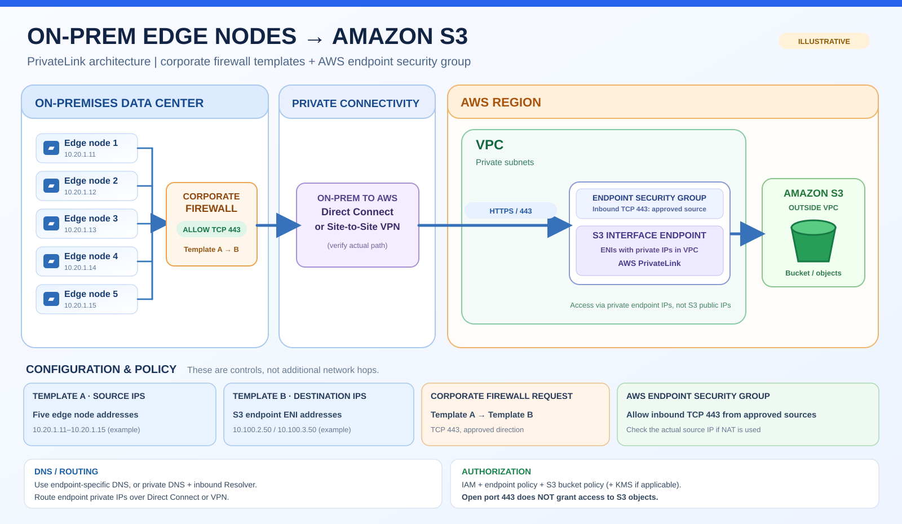
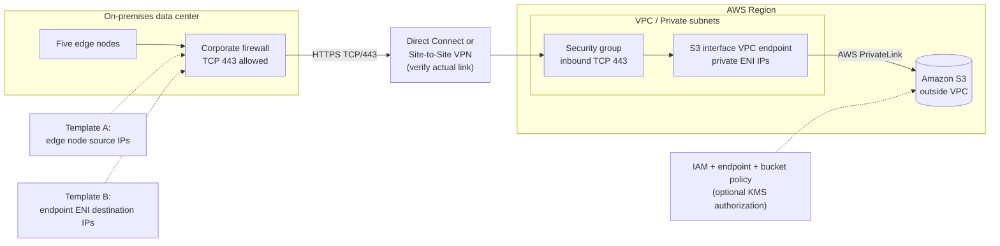

# Five on-premises edge nodes → Amazon S3 via AWS PrivateLink

> **Conceptual reference architecture, 2026-11-15.** All IP addresses below are illustrative. The precise AWS network link, NAT behavior, firewall product, endpoint subnets, and DNS setup must be verified in the organization. Firewall templates are logical source/destination IP groups, not actual network transit devices.

## What each component does

| Component | Responsibility |
| --- | --- |
| Five on-premises edge nodes | Initiate HTTPS requests to S3. Example addresses: `10.20.1.11` through `10.20.1.15`. |
| Firewall Template A | Logical group containing edge node **source** IPs. |
| Firewall Template B | Logical group containing the S3 **interface endpoint ENI destination** private IPs, for example `10.100.2.50` and `10.100.3.50`. Endpoint addresses shown are illustrative; check lifecycle/changes. |
| Corporate firewall request | Allows the intended direction: Template A → Template B, **TCP 443**. It may also require approved return-path/routing controls. |
| Direct Connect or Site-to-Site VPN | Provides routed private connectivity from the data center to the AWS VPC. The actual connectivity type is not confirmed. |
| AWS S3 interface VPC endpoint (PrivateLink) | Exposes private ENI IPs within VPC subnets; forwards allowed S3 HTTPS requests over the AWS network. **Do not substitute an S3 gateway endpoint for direct on-premises access.** |
| Security group on endpoint ENIs | Allows inbound TCP 443 from the **source addresses AWS actually sees**, which can differ from edge-node IPs if NAT is present. Security groups are stateful. |
| Amazon S3 | AWS regional service **outside the VPC**. Data plane accessed via interface endpoint. |
| IAM role/credentials, endpoint policy, bucket policy, optional KMS | Permit or deny S3 operations separately from network reachability. |

## Editable Mermaid overview

The dotted arrows represent **configuration and authorization**, not additional data-plane hops.

## End-to-end packet walkthrough

1. One edge node makes an HTTPS request using an appropriate S3 endpoint DNS name.
2. DNS returns private interface-endpoint ENI addresses. Either endpoint-specific DNS names or properly configured private DNS/Route 53 Resolver can be used; don't hardcode ENI IPs into applications.
3. The on-premises firewall evaluates **Template A → Template B on TCP 443**.
4. The IP route sends traffic across the approved private connection (Direct Connect or Site-to-Site VPN) toward the ENI private IP in the VPC.
5. The endpoint ENI's **security group** accepts the connection only if inbound TCP 443 is allowed from the actual, potentially NAT-translated source address. Also check NACLs and routing where relevant.
6. PrivateLink delivers the service request to Amazon S3 without requiring the on-premises node to use the public S3 network endpoint.
7. IAM/endpoint/bucket policies and possibly KMS permissions decide whether the requested read or write is authorized. A network connection is not an S3 permission.

## Firewall request example (illustrative)

| Field | Example |
| --- | --- |
| Source group | Template A: edge node IPs `10.20.1.11–10.20.1.15` |
| Destination group | Template B: S3 interface endpoint ENI IPs `10.100.2.50`, `10.100.3.50` |
| Protocol | TCP |
| Destination port | 443 |
| Direction | On-prem edge nodes → S3 endpoint |
| Routing | Data center ↔ AWS VPC through approved private connectivity |
| AWS security group | Inbound TCP 443 from effective on-prem source IPs |
| DNS | Endpoint-specific name, or on-prem conditional forwarding to an inbound Route 53 Resolver for private DNS |
| S3 permission | Restricted identity policy + endpoint policy + bucket policy; KMS when applicable |

## Failure checks

- **DNS resolves to public S3 addresses:** validate endpoint URL, private DNS design, and on-prem Resolver forwarding.
- **Connection timeout:** check corporate firewall rule, destination ENI IPs, on-prem routing, Direct Connect/VPN routes, endpoint security group, and NACLs.
- **Connection works but HTTP 403:** check the caller IAM identity, endpoint policy, bucket policy, requested bucket/prefix, and KMS access. A 403 may also have endpoint-specific policy causes.
- **Only some nodes fail:** compare node IP group membership, NAT changes, and source-specific rules.
- **Previously working IPs changed:** examine endpoint ENI lifecycle and revalidate destination groups if network controls list individual IPs rather than managed hostnames or automation.

## AWS references

- [AWS PrivateLink for Amazon S3](https://docs.aws.amazon.com/AmazonS3/latest/userguide/privatelink-interface-endpoints.html)
- [S3 gateway versus interface endpoint and private DNS](https://docs.aws.amazon.com/vpc/latest/privatelink/vpc-endpoints-s3.html)
- [Route 53 Resolver for on-premises DNS](https://docs.aws.amazon.com/Route53/latest/DeveloperGuide/resolver-overview-DSN-queries-to-vpc.html)

**Next verification in the actual environment:** capture the real *types* of network devices and endpoint, not their confidential IPs: is the private path Direct Connect or VPN, what source IP does the AWS endpoint receive (NAT or not), and does Template B hold endpoint ENI private IPs?
