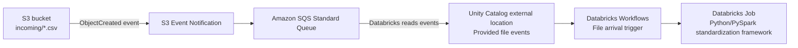

# AWS Learning Notes

## 2026-10-26: S3 → SQS → Databricks File Arrival Trigger

### Architecture

### Purpose
Trigger a Databricks batch job when files land in S3, without SNS, Lambda, or an always-running Auto Loader stream.

### AWS configuration
1. Create an **SQS Standard** queue in the supported region.
2. Add a queue resource policy allowing the specific S3 bucket to send messages (restrict by `aws:SourceArn` and `aws:SourceAccount`).
3. On the S3 bucket, configure an event notification for `s3:ObjectCreated:*` targeting the SQS queue. Add prefix/suffix filters where appropriate.
4. Ensure the IAM role used by the Databricks Unity Catalog storage credential has the documented SQS permissions (including receiving, deleting and inspecting queue messages). Confirm any required permissions with your platform administrator.

### Databricks configuration
1. Set up the Unity Catalog storage credential and external location covering the S3 path.
2. In the external location's file-event configuration, choose **Provided file events** and enter the SQS queue URL.
3. Enable/test file events as available in the workspace.
4. Create a Databricks Workflow job containing the standardization framework Python/PySpark task.
5. Configure a **File arrival** trigger pointing to the supported external location or volume path, then save and enable the job.
6. Upload a test file and verify that the event is delivered, the trigger fires, and the job processes the intended input.

### Operational considerations
- A notification is not the file content; the framework must read the object from S3.
- S3 event delivery is at least once and events can arrive out of order; make ingestion idempotent.
- A trigger signals a change, not necessarily one job run per object. Use checkpointing, audit tables or other deduplication to track processed files.
- Verify path filtering, SQS queue policies, IAM access, job permissions, supported regions, and event-service health.
- PrivateLink is a separate networking/security consideration; it is not inherently required just because SQS is used.
- Do not attach multiple independent consumers to the same queue without understanding message deletion and delivery semantics.

### References
- Databricks documentation: [File arrival triggers](https://docs.databricks.com/aws/en/jobs/file-arrival-triggers)
- Databricks documentation: [File events](https://docs.databricks.com/aws/en/ingestion/cloud-object-storage/file-events)
- AWS documentation: [S3 event notifications](https://docs.aws.amazon.com/AmazonS3/latest/userguide/EventNotifications.html)

### Future AWS topics to append
AWS account, IAM roles, S3, VPC endpoints and PrivateLink, EKS, EFS, MWAA, Airflow and event-driven ingestion.
